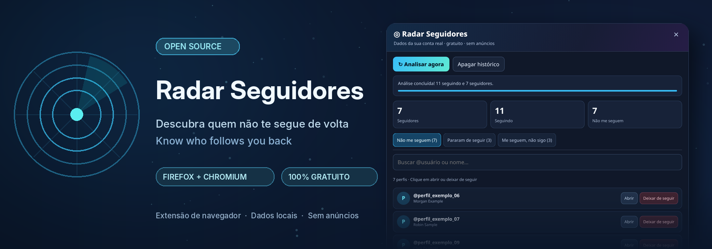
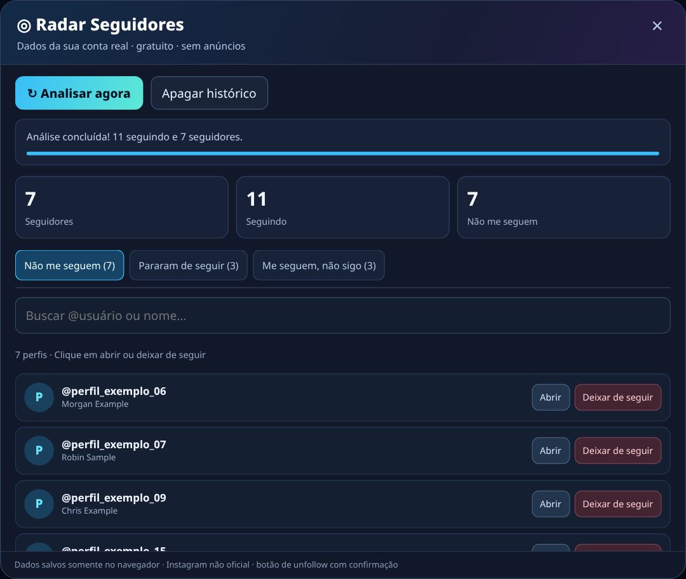
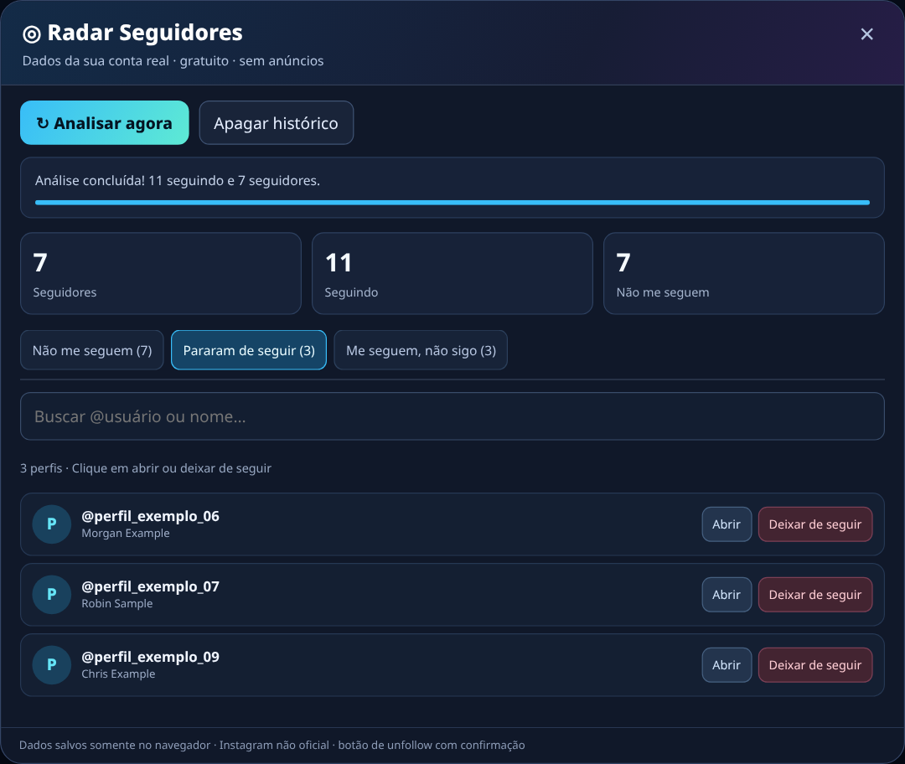
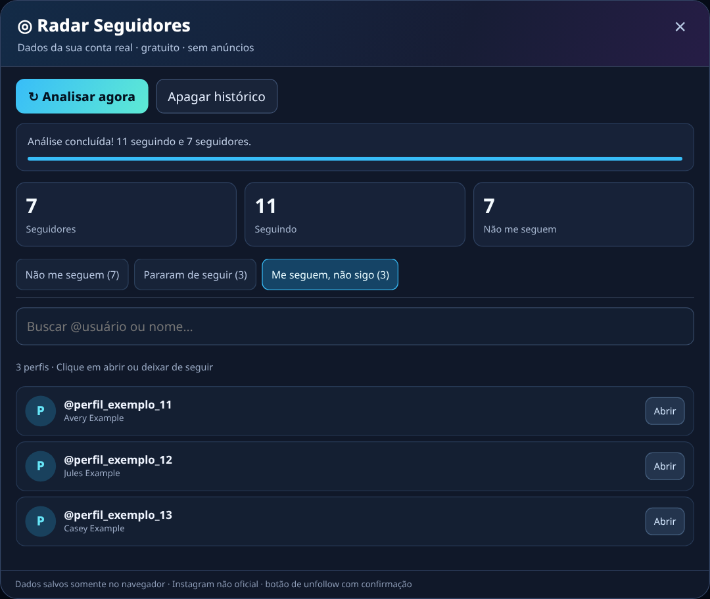

<p align="center"></p>

<h1 align="center">Radar Seguidores</h1>
<p align="center"><strong>Descubra quem não te segue de volta. Acompanhe unfollows. Gerencie seus seguidos.</strong></p>
<p align="center">Uma extensão gratuita e de código aberto para analisar seus seguidores do Instagram diretamente no navegador.</p>

<p align="center">
  <a href="https://github.com/pecanela/radar-seguidores/actions/workflows/ci.yml"></a>
  <a href="https://github.com/pecanela/radar-seguidores/releases"></a>
  <a href="LICENSE"></a>
  <a href="#compatibilidade"></a>
</p>
<p align="center">
  <a href="https://github.com/pecanela/radar-seguidores/releases"><b>⬇️ Downloads</b></a> ·
  <a href="#instalação"><b>🚀 Instalação</b></a> ·
  <a href="#demonstração"><b>🖼️ Demonstração</b></a> ·
  <a href="#perguntas-frequentes"><b>❓ Perguntas frequentes</b></a>
</p>
<p align="center">🇧🇷 <b>Português</b> · <a href="README.en.md">🇺🇸 English</a></p>

> [!IMPORTANT]
> **Versão beta para desktop.** A versão anterior foi testada no Firefox; esta versão e os pacotes Chromium ainda precisam de validação com contas reais. Os downloads da página **Releases** são pacotes de teste, não extensões assinadas por lojas. A versão Android/APK não está disponível.

---

## Por que usar?

Quando você segue muitas pessoas, é difícil identificar quem não segue você de volta ou quem deixou de seguir desde a última consulta. O Radar Seguidores organiza essas informações em três listas, com busca e acesso rápido a cada perfil.

| Não me seguem | Pararam de seguir | Me seguem, não sigo |
|:---|:---|:---|
| **Você segue**, mas a pessoa não segue você. | A pessoa **seguia antes**, não segue mais e você ainda segue. | A pessoa **segue você**, mas você não segue de volta. |
| Disponível na primeira análise. | Requer duas análises completas em datas diferentes. | Disponível na primeira análise. |

**Também inclui:** pesquisa por nome/@usuário, abertura do perfil, botão individual **Deixar de seguir** com confirmação, histórico local por conta e opção de apagar as análises salvas.

## Demonstração

<p align="center">
  <a href="docs/images/nao-me-seguem.png"></a>
  <br><sub>Lista de contas que você segue e que não seguem você de volta.</sub>
</p>

<table>
  <tr>
    <td width="50%" align="center"><a href="docs/images/pararam-de-seguir.png"></a><br><sub><b>Pararam de seguir</b> — comparação histórica</sub></td>
    <td width="50%" align="center"><a href="docs/images/me-seguem-nao-sigo.png"></a><br><sub><b>Me seguem, não sigo</b> — seguidores sem reciprocidade</sub></td>
  </tr>
</table>

<sub>Capturas da interface real da extensão, executada com dados sintéticos de demonstração. Nenhuma conta real foi exposta.</sub>

## Instalação

### 1. Baixe o pacote do seu navegador

Acesse **[Releases](https://github.com/pecanela/radar-seguidores/releases)** e, na versão `v1.1.0-beta.1`, baixe:

| Navegador | Arquivo |
|---|---|
| 🦊 Firefox (desktop) | `Radar-Seguidores-Firefox-v1.1.0-beta.1.zip` |
| 🌐 Chrome, Edge, Brave (desktop) | `Radar-Seguidores-Chromium-v1.1.0-beta.1.zip` |

**Extraia o ZIP** para uma pasta de sua escolha. O `manifest.json` deve aparecer dentro da pasta extraída, junto de `main.js` e `logic.js`.

### 2A. Firefox — Windows, macOS ou Linux

1. Abra `about:debugging#/runtime/this-firefox` no Firefox.
2. Clique em **Carregar extensão temporária** (*Load Temporary Add-on*).
3. Selecione o arquivo **`manifest.json`** que você extraiu.
4. Acesse **[instagram.com](https://www.instagram.com/)**, entre na sua conta e atualize a página.
5. Clique em **◎ Radar Seguidores** no canto inferior direito e selecione **Analisar agora**.

> [!NOTE]
> No Firefox estável, a instalação acima é **temporária** e desaparece ao reiniciar o navegador. A instalação permanente requer assinatura pela Mozilla; ela ainda não está disponível para esta versão.

### 2B. Chrome, Edge ou Brave — desktop

1. Abra `chrome://extensions`, `edge://extensions` ou `brave://extensions`.
2. Ative **Modo do desenvolvedor**.
3. Clique em **Carregar sem compactação** (*Load unpacked*).
4. Selecione a **pasta extraída** que contém `manifest.json`.
5. Entre no **[Instagram](https://www.instagram.com/)**, atualize a página e abra **◎ Radar Seguidores**.

Mantenha a pasta extraída no mesmo local enquanto usar a extensão; não precisa de Python, Node.js ou outro programa para executar os pacotes prontos.

### 3. Primeira análise e acompanhamento

1. Faça login no Instagram normalmente, no mesmo navegador da extensão.
2. Clique em **Analisar agora** e aguarde o carregamento completo de seguidores e seguidos.
3. Use as abas **Não me seguem**, **Pararam de seguir** e **Me seguem, não sigo**.
4. Para deixar de seguir alguém, clique no botão individual e **confirme** a ação.
5. Faça uma nova análise em outra ocasião para detectar quem deixou de seguir **desde a análise anterior**.

> [!WARNING]
> A primeira leitura **não recupera o histórico de pessoas que deixaram de seguir antes da instalação**. O Instagram pode limitar a coleta, especialmente em contas grandes. Aguarde o intervalo indicado pelo aplicativo e não execute ações em sequência excessiva.

## Compatibilidade

| Plataforma | Situação |
|---|---|
| Firefox — desktop | Protótipo anterior validado em uso real; pacote beta atualizado requer reteste. |
| Chrome / Edge / Brave — desktop | Pacote compilado e disponível para testes; validação real pendente. |
| Firefox — Android | Em avaliação; exige versão compatível/assinada e testes no aparelho. |
| Chrome / Brave — Android | Não suportam a instalação convencional destes pacotes desktop. |
| APK Android | Não disponível; protótipo anterior não foi validado para distribuição. |

## Privacidade por padrão

- **Sem senha no Radar:** usa a sessão já aberta em `instagram.com`, sem uma tela própria de login.
- **Sem servidor do projeto:** as listas e o histórico ficam no armazenamento local da extensão, separados por conta.
- **Sem anúncios nem rastreadores adicionados pelo projeto.**
- **Permissões limitadas:** acesso a `instagram.com` e ao armazenamento necessário para salvar os resultados.
- **Controle individual:** cada solicitação de unfollow pede confirmação; não há opção de unfollow em massa.

> [!CAUTION]
> O Radar Seguidores utiliza **interfaces internas não oficiais do Instagram**. Elas podem mudar, apresentar falhas ou provocar limites/restrições na conta. O projeto não é afiliado, patrocinado ou endossado pela Meta ou Instagram. Código público não é garantia de segurança absoluta.

[Política de privacidade](docs/PRIVACIDADE.md) · [Segurança](docs/SEGURANCA.md) · [Checklist de publicação](docs/PUBLICACAO.md)

## Perguntas frequentes

<details><summary><b>Como descobrir quem deixou de me seguir?</b></summary><br>Faça uma análise completa, mantenha o histórico local e repita a análise em outra data. Só é possível confirmar mudanças ocorridas entre os registros armazenados.</details>

<details><summary><b>Consigo ver quem nunca me seguiu?</b></summary><br>Sim. A aba <b>Não me seguem</b> compara a lista atual de seguidores com as contas que você segue; ela não indica quando ou por que a pessoa deixou de seguir.</details>

<details><summary><b>O botão “Deixar de seguir” modifica minha conta?</b></summary><br>Sim. Após confirmar, o aplicativo solicita a ação ao Instagram. Verifique o perfil antes de confirmar. Se a rede ou o Instagram falhar, confira o resultado diretamente no perfil.</details>

<details><summary><b>Por que o escaneamento demora ou mostra erro 429?</b></summary><br>O Instagram pode limitar o número de solicitações. Não force repetidas tentativas: aguarde e tente novamente mais tarde. Uma leitura incompleta não deve ser interpretada como lista definitiva.</details>

<details><summary><b>Os meus seguidores vão para algum servidor?</b></summary><br>O projeto não opera um servidor de coleta. As consultas necessárias são realizadas com o Instagram e as análises são armazenadas localmente no navegador, até serem apagadas pelo usuário ou pelo próprio navegador.</details>

<details><summary><b>Posso instalar no celular?</b></summary><br>A versão atual foi preparada para navegadores de computador. O Firefox Android está em avaliação; ainda não existe APK validado para distribuição.</details>

<details><summary><b>Como apagar tudo?</b></summary><br>Abra o painel do Radar Seguidores e clique em <b>Apagar histórico</b> para excluir as análises da conta em uso. Você também pode remover a extensão do navegador.</details>

## Desenvolvimento

O projeto utiliza **JavaScript**, WebExtensions (Manifest V3) e armazenamento local. Não exige backend nem dependências de execução instaladas pelo usuário.

```bash
git clone https://github.com/pecanela/radar-seguidores.git
cd radar-seguidores
npm test
npm run build
```

Requer Node.js 18+ para desenvolver. Os pacotes de teste são gerados em `dist/firefox/` e `dist/chromium/`. O [GitHub Actions](https://github.com/pecanela/radar-seguidores/actions/workflows/ci.yml) executa os testes e o build a cada atualização.

## Roadmap

- [x] Comparação de seguidores e seguidos
- [x] Histórico local e detecção de unfollows entre análises
- [x] Pacotes Firefox e Chromium
- [x] Testes automatizados e build no GitHub Actions
- [ ] Validação da versão atual em Firefox, Chrome, Edge e Brave
- [ ] Assinatura/publicação em lojas de extensões
- [ ] Avaliação e testes para Firefox Android
- [ ] Tradução da interface para inglês

## Contribua

Correções, melhorias de acessibilidade, traduções e testes em navegadores diferentes são bem-vindos. Abra uma [issue](https://github.com/pecanela/radar-seguidores/issues) ou envie um pull request. Não anexe cookies, tokens, listas completas de seguidores ou outras informações pessoais.

Leia [CONTRIBUTING.md](CONTRIBUTING.md) · Confira o [histórico de versões](CHANGELOG.md) · Acesse as [Releases](https://github.com/pecanela/radar-seguidores/releases)

---

<p align="center">Licenciado sob <a href="LICENSE">MIT</a> · Desenvolvido e mantido em <a href="https://github.com/pecanela/radar-seguidores">pecanela/radar-seguidores</a>.</p>
<p align="center"><strong>Feito para dar mais controle sobre suas conexões — sem anúncios e sem complicação.</strong></p>
